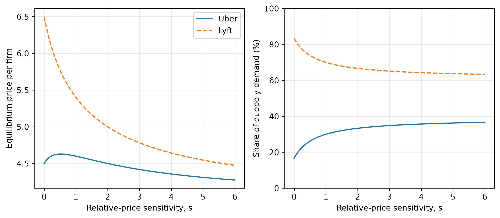

# Price Competition in a Differentiated Duopoly: A Model Inspired by Uber and Lyft

If two firms charge the same price, why would both lower it when riders become more sensitive to price differences? This Python project lets you change that sensitivity, inspect each firm's best response and see where the two responses intersect. A separate analysis compares observed base fares on one Brooklyn route.

[Interactive notebook](notebooks/simulator.ipynb) · [Model implementation](duopoly/model.py) · [Observed fare summary](data/processed/summary.csv)

## Try the simulator

Use Python 3.12 and run the commands from the repository root. The project has been exercised on Linux with Python 3.12.3.

1. Create an environment with `python3.12 -m venv .venv`. On Windows with the Python launcher, the equivalent is `py -3.12 -m venv .venv`.
2. Activate it with `source .venv/bin/activate` in bash or zsh, or `.venv\Scripts\Activate.ps1` in PowerShell.
3. Install the dependencies and start JupyterLab:

   ```sh
   python -m pip install -r requirements.txt -e .
   python -m jupyterlab notebooks/simulator.ipynb
   ```

Run all cells using the Python kernel from that environment. The initial scenario gives model prices of **4.6 for Uber and 5.4 for Lyft**, with shares of **30% and 70%**. Select **Symmetric demand** to remove Lyft's initial advantage. Both shares become 50%. Increase relative-price sensitivity and observe what happens to the common price. **Reset to F1** restores the starting values. The simulator and the three model figures run without trip data.

## What the model measures

Each firm chooses a price at or above the common unit cost. A unilateral price cut reduces its margin but can win demand while its rival's price stays fixed. With symmetric firms, greater sensitivity to the price gap makes that cut more attractive even when the initial gap is zero. The equilibrium moves to a lower common price.

In the asymmetric example below, Lyft starts with a demand advantage. As relative-price sensitivity rises, the price gap narrows and Lyft retains the larger share. Model prices are in illustrative units. The scenarios are independent of the Brooklyn sample.



## Reproduce the model figures

```sh
python scripts/generate_figures.py
```

The script reads [the three scenarios](figures/scenarios.json) and writes PDF and PNG versions to [figures/generated](figures/generated/).

| Scenario | What to look for |
|---|---|
| F1 · Best responses | The intersection gives a price at which each firm is choosing its best response to the other. |
| F2 · Symmetric demand | Vary relative-price sensitivity while holding costs and base demand fixed. The firms' common price and profit fall. |
| F3 · Asymmetric demand | The lower-demand firm's price initially rises even as the price gap narrows. The two firms retain different shares. |

## Reproduce the Brooklyn fare comparison

The sample covers completed trips from Williamsburg (North Side) to Greenpoint, Brooklyn (TLC zones 255 to 112), from 13 to 19 January 2025 inclusive. Eligible trips have positive finite base fare, distance and duration, with neither a shared request nor a shared match.

| Provider | Eligible trips | Sample share | Median base passenger fare |
|---|---:|---:|---:|
| Uber | 3,707 | 74.01% | $10.69 |
| Lyft | 1,302 | 25.99% | $10.62 |

The seven-cent difference describes this route and week. The records contain completed trips and do not establish how riders would respond to a change in price. See the [filter counts](data/processed/filter_audit.json), [full summary](data/processed/summary.csv) and [fare distribution](figures/generated/fare_distribution.png).

To rebuild these results, download the January 2025 High Volume FHV Parquet file (about 469 MiB). Run the following once from the repository root. It reads the official file URL and expected SHA-256 from [the sample specification](data/sample.json), creates the destination directory and checks the download.

```sh
python -c "from pathlib import Path; from duopoly.data import read_sample_spec, fetch_source; s = read_sample_spec(Path('data/sample.json')).source; fetch_source(s['url'], Path('data/raw') / s['filename'], s['sha256'])"
```

If the file is already in place, go straight to processing:

```sh
python scripts/process_data.py
```

The script verifies the input again, rebuilds both aggregate files in `data/processed/` and writes F4 in both figure formats. Of 5,102 candidate trips, the shared-ride filters exclude 93. The boxplot hides outlier markers but retains those trips in the summary.

To retrace the choice of route, run `python scripts/explore_routes.py`. It ranks routes by the smaller of their two provider counts and uses the TLC zone table for names. Then `python scripts/inspect_candidate.py` describes the selected route before the final exclusions. Both scripts read the same local Parquet.

**Data sources.** The monthly trip records and the zone lookup table are published by the New York City Taxi and Limousine Commission. The base fare field excludes tips, tolls, taxes and fees. [TLC trip records and zone lookup](https://www.nyc.gov/site/tlc/about/tlc-trip-record-data.page) · [High Volume FHV data dictionary](https://www.nyc.gov/assets/tlc/downloads/pdf/data_dictionary_trip_records_hvfhs.pdf)

## Repository guide

| Location | Contents |
|---|---|
| [duopoly/](duopoly/) | Demand, profits, best responses, equilibrium, trip filtering and plotting functions. |
| [notebooks/](notebooks/) | Interactive simulator with parameter controls. |
| [scripts/](scripts/) | Entry points for figure generation, data processing and route selection. |
| [figures/](figures/) | Model scenarios and the four saved figures. |
| [data/](data/) | Source specification, zone lookup and aggregate outputs. The original trip file is downloaded locally. |

## Authors

Elya Verhoeven, Jorge Sobrino and Jorge López.
